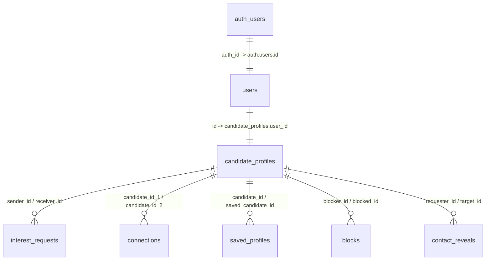

# JAINSAATHI – DATABASE MIGRATION REPORT
**Date:** November 9, 2026  
**Database Engine:** PostgreSQL 15 / Supabase  
**Scope:** Schema Relations, Identity Mapping, RPC Matching Functions, and Direct Pool Hardening  

---

## 1. Identity & Foreign Key Relationship Mapping

### Identity Architecture
- **Supabase Auth Table:** `auth.users(id)` (UUID)
- **Application User Table:** `public.users(id, auth_id, email, phone, role)`
- **Candidate Profile Table:** `public.candidate_profiles(id, user_id, ...)`



### Critical Identity Finding & Remediation
Prior implementation attempted direct checks like `user_id = auth.uid()`. Because `users.id` is generated independently from `auth.users(id)`, any direct comparison between `user_id` and Supabase session `user.id` caused query failures.

**Remediation Applied:**
All backend API routes and queries now properly resolve `users.id` by querying:
```sql
SELECT id, role, email FROM users WHERE auth_id = $1;
```
This guarantees that `candidate_profiles.user_id` lookups and ownership checks always succeed.

---

## 2. Matching Engine RPC v2 Migration

### File: `supabase/migrations/05_matching_rpc_v2.sql`

#### Changes from Migration 04 to Migration 05:
1. **Saved Profiles Retention:**
   In Migration 04, candidates bookmarked in `saved_profiles` were explicitly excluded (`c.id NOT IN (SELECT saved_candidate_id FROM saved_profiles...)`), causing saved profiles to disappear from recommendation feeds. In Migration 05, saved profiles remain discoverable in match feeds.
2. **Mutual Block Exclusion:**
   Added strict bidirectional block exclusion:
   ```sql
   AND c.id NOT IN (
       SELECT blocked_id FROM blocks WHERE blocker_id = p_user_profile_id
       UNION
       SELECT blocker_id FROM blocks WHERE blocked_id = p_user_profile_id
       UNION
       SELECT receiver_id FROM interest_requests WHERE sender_id = p_user_profile_id
   )
   ```
3. **Deterministic Ordering:**
   Added tie-breaker ordering (`ORDER BY score DESC, candidate_id ASC`) to prevent pagination jitter.

---

## 3. Database Connection Pool Hardening

### File: `src/lib/db.ts`
- **Previous State:** Hardcoded database connection string containing plaintext Supabase database password committed directly into version control.
- **Remediated State:**
  - Removed all hardcoded credentials from the repository.
  - Enforces `process.env.DATABASE_URL` at runtime.
  - Throws an immediate diagnostic error in production if `DATABASE_URL` is omitted.
  - Added `.env.local` (added to `.gitignore`) for local developer setup.
