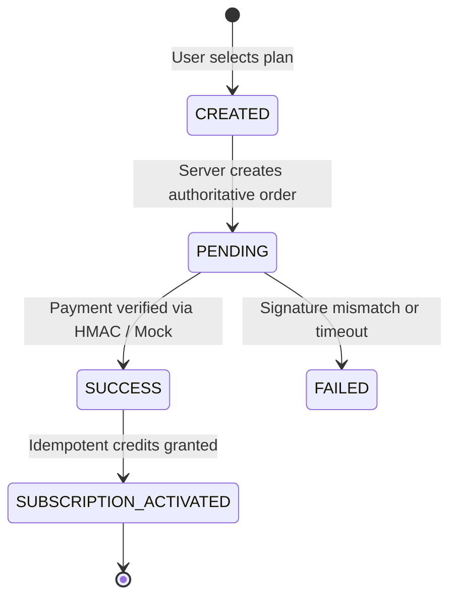

# JAINSAATHI – PAYMENT INTEGRATION REPORT
**Date:** November 9, 2026  
**Status:** Dual Engine (Mock Mode / Production Razorpay Ready)  
**Endpoints:** `/api/payments/order`, `/api/payments/verify`  

---

## 1. Payment Engine Architecture

The payment system is designed with a strict server-authoritative state machine and transparent mode awareness.

---

## 2. Server-Authoritative Pricing

- **Database Plan Truth:** Clients submit only `planId`. Prices are never accepted from client request bodies.
- The server retrieves `price_inr`, `duration_days`, `contact_reveal_limit`, and `biodata_download_limit` directly from the `plans` table in PostgreSQL.
- **Female 1-Year Free Benefit:** The server inspects candidate gender in the database; female candidates selecting Free or Pro tiers receive complimentary 1-year activation automatically without payment gateway invocation.

---

## 3. Dual Mode Execution (Mock vs Live)

| Feature | Mock Mode | Live Mode (Razorpay) |
|---|---|---|
| **Trigger Condition** | `RAZORPAY_SECRET` not set OR `mockMode: true` | `RAZORPAY_KEY_ID` and `RAZORPAY_SECRET` set in `.env` |
| **Order ID Format** | `order_mock_<timestamp>` | `order_<razorpay_id>` |
| **Verification** | Instant simulation with simulated audit log | HMAC SHA-256 signature verification |
| **Provider Stored** | `'mock'` | `'razorpay'` |
| **Subscription Activation** | Instant database insertion | Instant database insertion upon valid signature |
| **Client Mode Flag** | `mockMode: true` returned to client | `mockMode: false` returned to client |

---

## 4. Idempotency & Replay Protection

In `/api/payments/verify/route.ts`:
1. Queries database for existing payment with `provider_order_id`.
2. If status is already `'success'`, returns `200 OK` ("Payment already verified") without double-crediting contact reveals or extending subscription dates twice.
3. Updates payment record and inserts subscription record within an isolated transaction.
